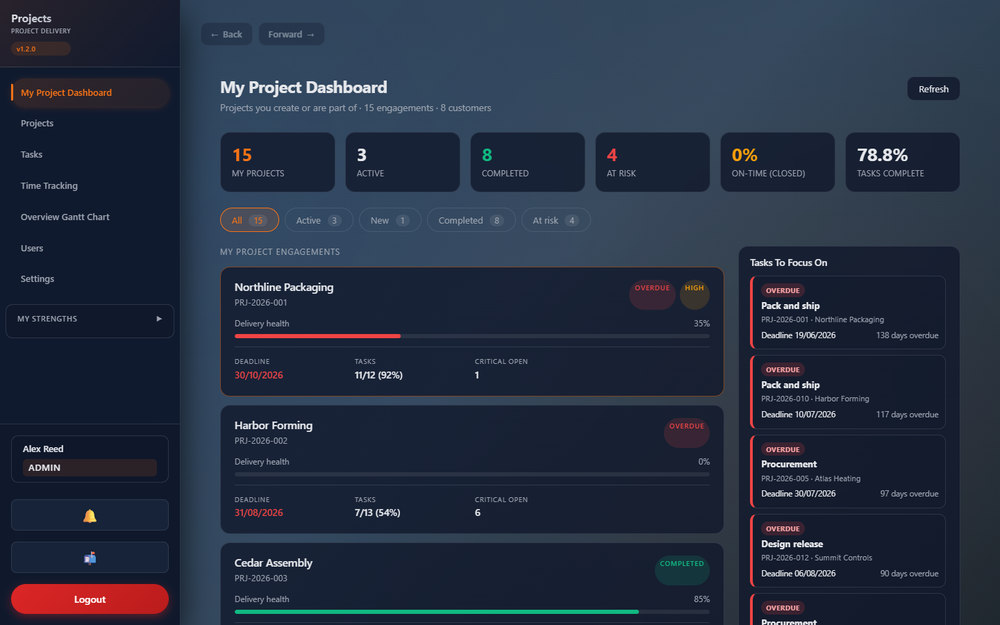
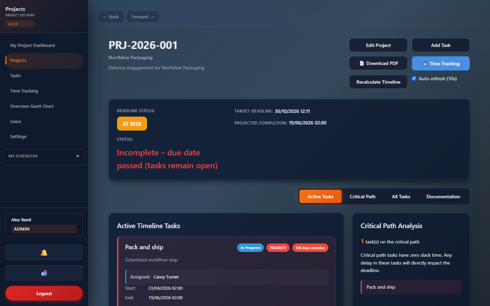
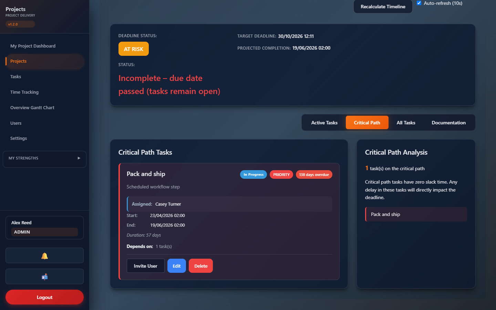

# Project delivery

The dashboard counts every engagement and flags the ones at risk. Opening a project shows the deadline against the projected finish, and the critical path names the step with no slack.

## Stack

<table>
<tr>
<td valign="top" width="50%">

<strong>Frontend</strong>
<ul>
<li>React 18</li>
<li>TypeScript</li>
<li>Webpack</li>
</ul>

<strong>Languages</strong>
<ul>
<li>TypeScript</li>
<li>SQL</li>
</ul>

<strong>Schedule</strong>
<ul>
<li>Forward pass sets the earliest start after the purchase arrives</li>
<li>Backward pass sets slack</li>
<li>Critical path is the steps with no slack</li>
<li>On track at 7 or more days of buffer, at risk below 7, late when the finish passes the deadline</li>
</ul>

</td>
<td valign="top" width="50%">

<strong>Backend</strong>
<ul>
<li>Node.js and Express</li>
<li>TypeORM</li>
<li>SQLite</li>
</ul>

<strong>Frameworks</strong>
<ul>
<li>React Router</li>
<li>Recharts</li>
<li>jsPDF, for the timeline report</li>
</ul>

<strong>Orders</strong>
<ul>
<li>Workflow steps and their dependencies</li>
<li>A purchase delivery date that holds the next step</li>
<li>Admin, project manager, and user roles</li>
</ul>

</td>
</tr>
</table>

## Run it

No install. Double-click `Open-Demo.ps1`, or open `demo/index.html` in Chrome or Edge.

The walkthrough plays on its own: the dashboard, the at-risk filter, the order, the critical path, then the overview Gantt. Replay runs it again.

| What to look at | Result |
| --- | --- |
| Engagements | 15 |
| Active | 3 |
| Completed | 8 |
| At risk | 4 |
| On-time, closed | 0% |
| Tasks complete | 78.8% |
| Opened order | PRJ-2026-001, at risk |
| Deadline | 30/10/2026, tasks still open |
| Critical step | Pack and ship, 138 days overdue, no slack |

