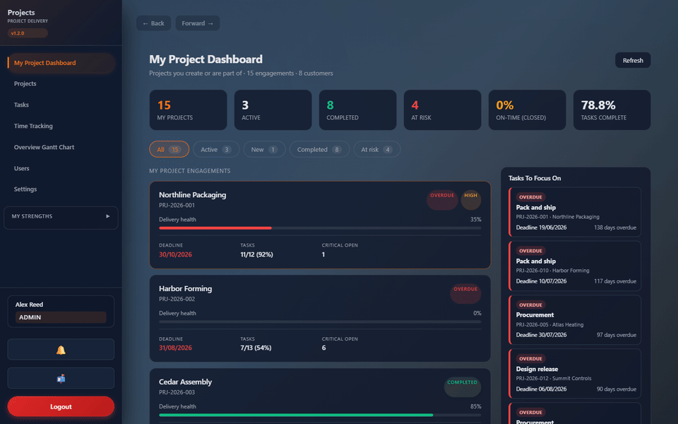
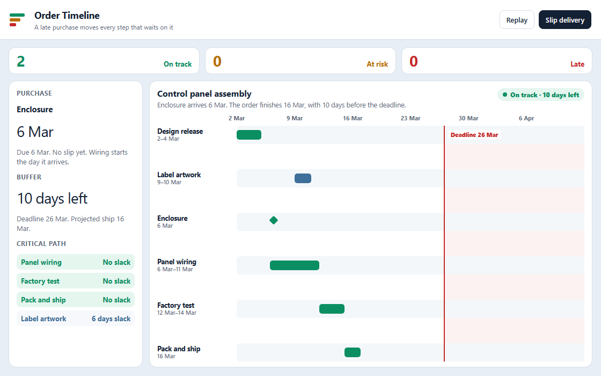
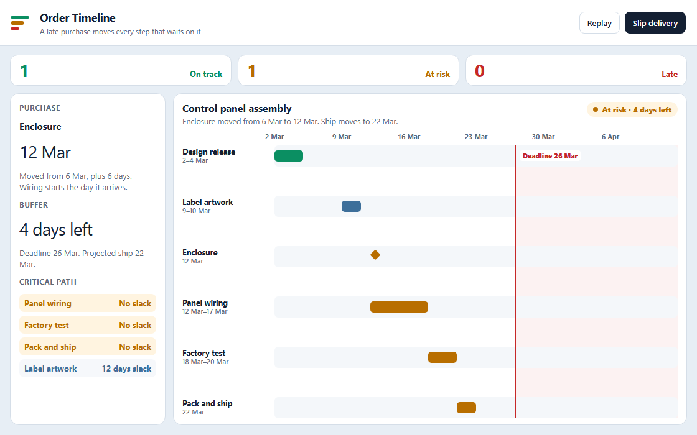
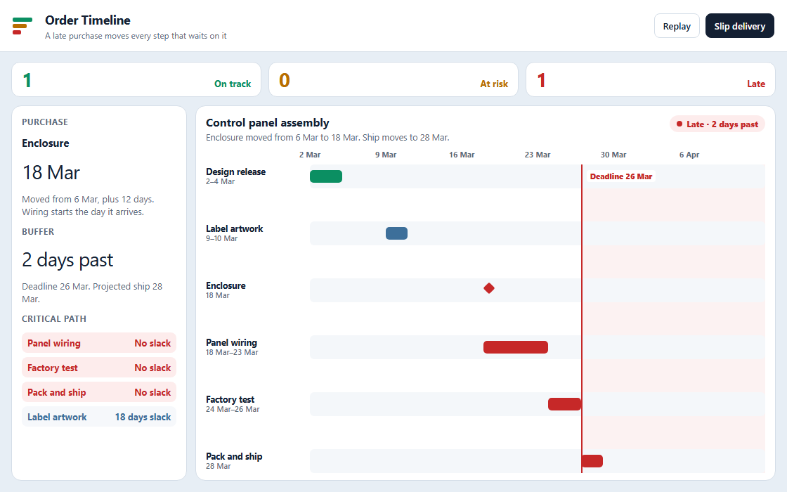

# Order Timeline

When a purchase arrives late, every step waiting on it shifts, and the order is marked on track, at risk, or late from the days left before the deadline.

## Stack

<table>
<tr>
<td valign="top" width="50%">

<strong>Frontend</strong>
<ul>
<li>React 18</li>
<li>TypeScript</li>
<li>Webpack</li>
</ul>

<strong>Languages</strong>
<ul>
<li>TypeScript</li>
<li>SQL</li>
</ul>

<strong>Schedule</strong>
<ul>
<li>Forward pass sets the earliest start after the purchase arrives</li>
<li>Backward pass sets slack</li>
<li>Critical path is the steps with no slack</li>
<li>On track at 7 or more days of buffer, at risk below 7, late when the finish passes the deadline</li>
</ul>

</td>
<td valign="top" width="50%">

<strong>Backend</strong>
<ul>
<li>Node.js and Express</li>
<li>TypeORM</li>
<li>SQLite</li>
</ul>

<strong>Frameworks</strong>
<ul>
<li>React Router</li>
<li>Recharts</li>
<li>jsPDF, for the timeline report</li>
</ul>

<strong>Orders</strong>
<ul>
<li>Workflow steps and their dependencies</li>
<li>A purchase delivery date that holds the next step</li>
<li>Admin, project manager, and user roles</li>
</ul>

</td>
</tr>
</table>

## Run it

No install. Double-click `Open-Demo.ps1`, or open `demo/index.html` in Chrome or Edge.

The order starts on its own. The enclosure is due 6 Mar, and the order is on track with 10 days of buffer. The delivery then slips 12 days. Replay runs that again. Slip delivery pushes the purchase later still.

| What to look at | Result |
| --- | --- |
| Orders on the board | 2 |
| Buffer before the slip | 10 days, on track |
| Enclosure delivery | 6 Mar, then 18 Mar |
| Ship date after the slip | 28 Mar |
| Against the 26 Mar deadline | Late, 2 days past |
| Steps with no slack | Panel wiring, factory test, pack and ship |
| Label artwork | Stays on 9–10 Mar |

